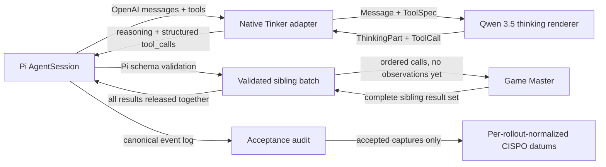

# Generative-World Harness Remediation Plan

## Status

**Implementation-ready plan. Training remains paused.**

This plan remediates the findings in
[`HARNESS_CRITICAL_AUDIT.md`](HARNESS_CRITICAL_AUDIT.md).
It is intentionally limited to harness correctness, training-data integrity,
and the minimum prompt/runtime cleanup required to trust a new baby run.

Human approval points and live evidence checks are extracted into
[`HARNESS_MANUAL_REVIEW_CHECKLIST.md`](HARNESS_MANUAL_REVIEW_CHECKLIST.md).

Do not resume the existing baby-v3 Tinker state. Its accepted rollout set
contains adapter-corrupted trajectories, so a later clean update would not make
that checkpoint trustworthy.

## Outcome

After this plan is implemented:

1. Pi sends normal OpenAI messages and structured tools.
2. The proxy converts those structures directly into Tinker's native Qwen 3.5
   renderer types.
3. Qwen reasons in the renderer's real thinking mode and returns native
   structured tool calls.
4. Pi validates every call before the simulated world sees it.
5. Sibling calls are evaluated as one assistant action, in a deterministic
   order, before any sibling observation is released.
6. The acceptance audit independently proves that the renderer, reasoning,
   tool-call, runtime, and correlation contracts held.
7. Each rollout has one total CISPO contribution regardless of how many model
   requests or compactions it contains.
8. Codex and Claude world runtimes use explicit, audited capability profiles.
9. A fresh baby run can proceed through one disposable update without relying
   on any contaminated checkpoint or trajectory.

## Canonical data flow



There is one authoritative transcript: Pi's structured messages and events.
Plain-text reconstructions are never substituted for tool calls, tool results,
or reasoning.

## Non-negotiable invariants

### Protocol

- The proxy must not invent a model-visible tool language.
- Tool specifications, assistant tool calls, and tool results remain structured
  across every boundary.
- An unparsed native renderer tool call is an infrastructure-format failure,
  not a final answer and not a low-reward policy action.
- A renderer/protocol incompatibility stops the rollout and is surfaced in the
  conductor state.
- The exact renderer name and thinking mode are pinned per rollout.

### Tool execution

- A proposed call is not world state.
- Only a call that has passed Pi's tool-name and argument-schema validation may
  enter the world.
- If one sibling is malformed, the complete assistant action is invalid. No
  valid-looking sibling from that message may mutate simulated state.
- Valid siblings retain message order.
- The world may evaluate siblings sequentially, but Pi receives no sibling
  observation until the complete result set exists.

### Training

- Infrastructure failures and simulator integrity failures are untrainable.
- Adapter corruption can never be converted into a low reward.
- A rollout is the unit of total loss weight.
- A compaction summary receives downstream terminal credit once, at the tail of
  the sequence that generated it. When it appears in the next request's prompt,
  it is masked context and receives no second loss.
- Missing reasoning quality/efficiency scores are neutral.

### Runtime boundaries

- A config label is not proof of isolation.
- Each world runtime writes a capability manifest derived from the command
  actually launched and the runtime initialization log.
- An unsupported runtime or an unproven capability boundary is untrainable.
- Prompts describe only guarantees the selected runtime actually provides.

## Phase 0 — Quarantine the invalid run

### Changes

1. Add a machine-readable invalidation marker to:

   ```text
   backend/research/player/simulator/generative_world/artifacts/hero/
     baby_first_hero_v1_2updates_20260717_v3/
   ```

   Suggested file:

   ```text
   INVALIDATED.json
   ```

   Required fields:

   ```json
   {
     "schema": "shellsmith.run_invalidation.v1",
     "invalid_for_training": true,
     "invalid_for_resume": true,
     "reason": "Non-native text tool adapter corrupted accepted trajectories and thinking was disabled.",
     "superseded_by": null
   }
   ```

2. Make `conductor.py` refuse to:

   - resume a run directory containing `INVALIDATED.json`;
   - load its optimizer/training state;
   - aggregate its accepted rollouts into a future update.

3. Keep the trajectories for research and viewer inspection. Do not delete or
   rewrite them.

### Proof

- A simulation-only or Tinker resume pointed at baby v3 fails before loading
  campaign reports or a Tinker state ID.
- The Observatory can still display the run and shows an invalidated badge.

## Phase 1 — Replace the text adapter with a native Tinker adapter

### New module

Create:

```text
backend/research/player/rl/llm_api_proxy/tinker_chat_adapter.py
```

Keep all Pi/OpenAI-to-Tinker translation in this module. `proxy.py` should own
HTTP and sampling lifecycle, not renderer-specific message reconstruction.

### Core routines

#### `openai_tools_to_tinker_specs(tools)`

Input is Pi's actual OpenAI shape:

```json
{
  "type": "function",
  "function": {
    "name": "read",
    "description": "Read the contents of a file.",
    "parameters": {
      "type": "object",
      "properties": {"path": {"type": "string"}},
      "required": ["path"]
    }
  }
}
```

Output is one native renderer `ToolSpec`:

```python
{
    "name": "read",
    "description": "Read the contents of a file.",
    "parameters": {...},
}
```

Rules:

- Reject non-function tools.
- Reject missing or duplicate names.
- Preserve the complete JSON Schema. Do not compact or rename it.
- Do not create friendly aliases.
- Compute a stable SHA-256 of the normalized tool list for audit correlation.

#### `openai_messages_to_tinker_messages(payload, hydrations, renderer)`

Rules:

- Preserve message order and roles.
- Require the Pi chat shape used by this harness: exactly one leading system
  message, followed by user/assistant/tool history. Pass that system text to
  `create_conversation_prefix_with_tools()`. Reject extra system/developer
  messages instead of guessing how to merge them.
- Convert user text and images into `TextPart` and `ImagePart`.
- Convert assistant reasoning into `ThinkingPart`.
- Convert assistant `tool_calls` into native `ToolCall` values, preserving IDs,
  names, and argument JSON exactly.
- Convert tool results into `Message(role="tool", tool_call_id=..., name=...)`.
- Reject a tool result with no matching earlier assistant call.
- Reject unsupported content parts. Do not stringify unknown structures.
- Do not truncate historical tool results in the correctness pass. If the 64k
  budget requires compaction, Pi owns compaction.

The renderer's `create_conversation_prefix_with_tools()` must build the native
tool declaration. The normal generation prompt is then built from that prefix
plus the structured conversation.

#### `tinker_message_to_openai_assistant(parsed_message)`

Rules:

- Convert `ThinkingPart` to the OpenAI-compatible reasoning field Pi consumes.
- Convert `TextPart` to visible assistant content.
- Convert native `ToolCall` values to OpenAI `tool_calls`.
- Preserve renderer-created call IDs; if the renderer omits an ID, assign one
  once at this boundary and persist it in the rollout record.
- If `unparsed_tool_calls` is nonempty, raise a typed protocol error. Never scan
  the text for a substitute call.
- Use `finish_reason="tool_calls"` when structured calls are present.
- Preserve the renderer's clean/malformed termination classification.

### Remove from the generative path

Delete or make unreachable:

- `allow_tools_in_tinker_text=True`;
- `messages_with_tool_prompt`;
- `tool_prompt_from_payload`;
- `compact_tool_schemas`;
- `stringify_message_for_tinker`;
- the custom `<tool_call name="...">` parser;
- parsing of `Assistant tool calls:` transcripts;
- alias recovery intended to repair duplicated legacy tool names;
- the marker `Previous tool-call history (not valid output)`.

If legacy OpenCode experiments still require the old adapter, move that code to
an explicitly named legacy module and make the shellsmith conductor
unable to select it. It must not remain as a fallback.

### `TinkerRolloutRecord` additions

Record:

- `api_shape`;
- `renderer_name`;
- `thinking_mode`;
- `parse_termination`;
- `tool_schema_sha256`;
- parsed tool-call IDs and names;
- `unparsed_tool_call_count`;
- assistant content-part types.

These fields are required evidence, not informational logging.

### Files changed

- `llm_api_proxy/proxy.py`
- new `llm_api_proxy/tinker_chat_adapter.py`
- `generative_world/campaign/conductor.py`
- `llm_api_proxy/README.md`
- `backend/tests/test_tinker_tool_call_streaming.py`
- new `backend/tests/test_tinker_chat_adapter.py`

### Exit gate A

Using a captured real Pi payload:

- all seven Pi tools retain their exact names and required fields;
- historical assistant calls remain native calls;
- tool results retain call IDs;
- Qwen generates `read(path=...)`;
- Pi receives the same call without any text parser;
- a malformed native XML call produces a typed protocol failure;
- no prompt or response contains any legacy marker or FCPXML
  instruction.

## Phase 2 — Make Pi's system prompt and thinking mode truthful

### Neutral Pi system prompt

Use Pi's supported `systemPromptOverride` to replace the stock coding-assistant
prompt. The replacement should say only:

- it is an agent operating in a task-specific environment;
- `/workspace` is the logical working directory;
- it should use the registered tools to investigate and act;
- it should ground conclusions in observations;
- it should answer concisely when finished.

Pi may still render its registered tools from their real schemas. The neutral
base prompt must not contain:

- “expert coding assistant”;
- Pi installation-document paths;
- the real temporary vat path;
- user-level resource locations;
- FCPXML material;
- OpenCode terminology.

Set the AGENTS resource's displayed path to `/workspace/AGENTS.md`, while the
tool executors continue to use the private physical cwd underneath.

### Thinking mode

In `vat_runner/pi-session.js`:

- keep `model.reasoning = true`;
- set `supportsReasoningEffort = true`;
- keep `thinkingLevel = "high"` for RFT;
- if Pi needs a `thinkingLevelMap`, explicitly map high to `high` and off to an
  unambiguous disabled value.

In the proxy:

- set a shellsmith-only `required_thinking_mode="thinking"`;
- reject a Pi request that omits or disables the expected signal;
- select `qwen3_5`, never `qwen3_5_disable_thinking`, for this RFT path;
- map sampled `ThinkingPart` content into Pi's `reasoning_content` stream;
- retain the same reasoning block in the completed Pi assistant message.

The world request must receive the exact completed `thinking` block from Pi's
`message_end` event. Reasoning must not be copied into visible assistant text.

### Required audit artifact

Write:

```text
scenario/model_protocol.json
```

It contains the expected renderer/thinking/tool hash and one record per model
request. The conductor writes it after draining live records and before running
the acceptance audit.

### Files changed

- `generative_world/episode/vat_runner/pi-session.js`
- `generative_world/episode/vat_runner/runner.js`
- `llm_api_proxy/proxy.py`
- `generative_world/campaign/conductor.py`
- `generative_world/episode/acceptance_audit.py`

### Exit gate B

One real no-training sample independently proves:

- run config says high thinking;
- Pi request contains the thinking signal;
- proxy chooses `qwen3_5`;
- raw renderer output contains reasoning;
- parsed output contains `ThinkingPart`;
- Pi event log contains a `thinking` block;
- the corresponding world turn request contains that same block;
- visible assistant text does not contain the hidden reasoning.

Any mismatch makes the rollout untrainable.

## Phase 3 — Validate complete sibling actions before world simulation

### Node lifecycle

Keep `message_end` as the declaration of sibling membership, but do not emit
world `tool_request` messages there.

Change each virtual tool's `executionMode` from `sequential` to `parallel`.
This does not make the simulated world concurrent. It lets Pi:

1. validate every sibling;
2. invoke every valid custom executor;
3. suspend all valid executor promises together.

`ToolBridge` then owns this state machine:

```text
DECLARED
  -> VALIDATED when every sibling executor has registered
  -> INVALID if Pi rejects any sibling before executor registration
  -> DISPATCHED only from VALIDATED
  -> RESOLVED after all world responses exist
  -> CONSUMED after Pi receives all results
```

### Invalid sibling handling

Pi emits `tool_execution_end` immediately when schema validation fails. The
runner must notify `ToolBridge` of that pre-executor failure.

If any sibling is invalid:

- dispatch none of the siblings to Python;
- reject or resolve every registered sibling executor with an ordinary Pi
  validation/action error;
- create no world request, response, or consistency-ledger entry;
- mark the model request as a protocol-integrity failure for acceptance.

### Valid sibling handling

Once all declared siblings have registered validated executors:

- emit all `tool_request` records to Python in assistant-message order;
- let `PiSdkVatProcess._run_prompt_loop` evaluate them sequentially;
- preserve the same pre-action reasoning/message context for each sibling;
- do not include an earlier sibling's observation in a later sibling's
  pre-action context;
- wait for every response;
- release all responses to Node in original order.

### Files changed

- `generative_world/episode/vat_runner/virtual-tools.js`
- `generative_world/episode/vat_runner/tool-bridge.js`
- `generative_world/episode/vat_runner/runner.js`
- `generative_world/vat_process.py`
- `generative_world/episode/bridge.py`
- `backend/tests/test_generative_world_vat.py`
- `vat_runner/test/tool-bridge.test.js`

### Exit gate C

- `read(file_path=...)` creates no world turn or ledger entry.
- In a message containing one valid and one invalid sibling, neither enters the
  world.
- Two valid siblings both enter the world once, in message order.
- Both receive identical pre-action reasoning.
- Pi receives neither result until both world responses are ready.
- A terminal response on one sibling does not erase the other sibling.

## Phase 4 — Make protocol integrity an independent acceptance gate

### New module

Create:

```text
backend/research/player/simulator/generative_world/protocol_integrity.py
```

It recomputes integrity from:

- `scenario/model_protocol.json`;
- `logs/vat.jsonl`;
- `world/turns/*/request.json`;
- `world/turns/*/response.json`;
- `world/consistency_ledger.json`;
- `run_config.json`.

The world model's `trainable` field cannot override this report.

### Required checks

For every sampled model request:

- expected renderer equals observed renderer;
- expected thinking mode equals observed mode;
- native parse termination is clean;
- `unparsed_tool_call_count == 0`;
- every assistant tool-call ID is unique;
- every validated call has exactly one world request;
- every world request has exactly one world response;
- every world response is returned once as a Pi tool result;
- names and arguments match at all four boundaries;
- malformed or Pi-rejected calls have no world request;
- sibling order is stable;
- tool result IDs reference an earlier call;
- model-record count matches completed assistant sample count;
- no legacy adapter marker appears in model-visible content;
- no plain text containing an unparsed native tool-call block is accepted as a
  terminal answer.

### Acceptance composition

`accepted_for_training` becomes:

```text
simulator_integrity
AND factual_consistency
AND host_boundary_safety
AND model_protocol_integrity
```

### Historical regression

Run the new audit against baby v3. Every trajectory containing
`Previous tool-call history (not valid output)` must fail
`model_protocol_integrity`, including the fourteen formerly accepted examples.

### Files changed

- new `generative_world/protocol_integrity.py`
- `generative_world/episode/acceptance_audit.py`
- `generative_world/campaign/conductor.py`
- `backend/tests/test_generative_world_acceptance_audit.py`
- new protocol-integrity fixtures under `backend/tests/fixtures/`

### Exit gate D

- All known corrupted baby-v3 trajectories are rejected.
- A clean native-renderer fixture is accepted.
- Removing any correlation record from the clean fixture makes it fail.

## Phase 5 — Unify world bootstrap around artifacts

### New boot artifact

All runtimes write:

```text
world/bootstrap/response.json
```

Do not use Codex `--output-schema` or Claude `--json-schema` for bootstrap.
Boot uses the same file-artifact and same-thread repair pattern as normal turns
and final judging.

### Reduced boot contract

The world model uniquely determines only:

```json
{
  "status": "ready",
  "private_initial_commitments": ["..."],
  "failure_reason": null
}
```

The orchestrator already owns or can verify:

- the exact Player prompt;
- the vat path;
- the allowed vat file list;
- whether `AGENTS.md` exists and is unchanged;
- the private world file;
- the simulation-root path.

Remove `initial_prompt`, `vat_agents_path`, `vat_files`, and
`private_world_summary` from the required generated contract.

### Boot validation

The orchestrator:

1. validates `world/bootstrap/response.json`;
2. verifies the physical vat contains exactly one regular `AGENTS.md`;
3. verifies the generated AGENTS file does not contain private task sections or
   simulator terminology;
4. writes the embedded prompt directly from
   `spec.player_projection()`;
5. copies the accepted boot artifact into the scenario audit area;
6. initializes the ledger exactly once.

An invalid boot artifact is unpublished. The repair prompt must say:

> Correct the unpublished artifact. Preserve real private state that may already
> have been initialized, but do not preserve malformed JSON or claims that were
> never delivered to the Player.

Remove “preserve the public observation you already committed to” from generic
artifact repair.

### Files changed

- `generative_world/episode/orchestrator.py`
- `generative_world/gm_process/`
- `generative_world/schemas.py`
- `generative_world/world_artifacts.py`
- `prompts/WORLD_BOOTSTRAP_PROMPT.md`
- `prompts/WORLD_ARTIFACT_REPAIR_PROMPT.md`
- bootstrap tests in `backend/tests/test_generative_world_vat.py`
- Claude tests in `backend/tests/test_generative_world_*process*.py`

### Exit gate E

- Sonnet performs repeated boots without `StructuredOutput` corruption.
- Codex and Claude use the same boot artifact.
- A malformed artifact is repaired in the same thread.
- The ledger is created once, after acceptance.

## Phase 6 — Make provider retry artifact-aware and idempotent

### Remove blind internal replay

`ClaudeWorldProcess` must not automatically resend the identical prompt after a
transport failure.

Replace the loose `start`/`resume` arguments in `ResumableAgentProcess` with a
small runtime-neutral turn context containing:

- logical stage;
- expected artifact path;
- request idempotency key;
- optional response schema path for validation only, never CLI structured
  output.

Instead, it returns or raises a typed transient failure containing:

- runtime;
- session ID, if known;
- physical attempt number;
- raw log path;
- expected artifact path;
- request idempotency key.

### Orchestrator recovery

On a transient failure:

1. Check the expected artifact.
2. If it is present and valid, accept it; the lost conversational result is
   irrelevant.
3. If it is missing or invalid, resume the same session with a recovery prompt.
4. The recovery prompt names the same idempotency key and tells the world agent
   to inspect existing private state before repeating any mutation.
5. Do not create a new logical world turn or increment the ledger revision.
6. If recovery remains ambiguous, mark the rollout untrainable.

This is sufficient for the first hero run because world agents may mutate only
their private simulation root. They are not authorized to mutate real remote
systems.

### Files changed

- `generative_world/gm_process/`
- `generative_world/episode/orchestrator.py`
- `generative_world/episode/bridge.py`
- retry prompts and process tests

### Exit gate F

- Provider failure after a valid artifact write does not replay the turn.
- Provider failure before artifact write resumes the same thread and logical
  action.
- A repeated recovery never creates two response artifacts or ledger entries.
- Ambiguous delivery is untrainable, never converted to a tool error for Player.

## Phase 7 — Make Codex and Claude runtime boundaries explicit

### Shared runtime manifest

Write:

```text
scenario/gm_runtime_manifest.json
```

Required fields:

- runtime and exact model;
- executable path and version;
- normalized launch arguments;
- cwd and additional writable roots;
- requested tool allowlist;
- observed tool inventory from initialization;
- user config/plugins/skills/MCP status;
- filesystem policy;
- network policy;
- manifest SHA-256.

`run_config.json` references the manifest hash. It does not claim isolation by
setting `world_permission_profile`.

### Codex profile

Keep:

- `--ignore-user-config`;
- `--ignore-rules`;
- episode-only cwd;
- explicit additional writable vat directory during bootstrap;
- a named permission profile with network enabled and only episode roots
  writable;
- JSONL command/tool logging.

The actual command and runtime events must match the manifest.

### Claude profile

Launch Claude with:

- `--safe-mode`;
- `--strict-mcp-config`;
- `--disable-slash-commands`;
- `--no-chrome`;
- `--tools Bash,Read,Write,Edit,Glob,Grep,WebSearch,WebFetch`;
- the same explicit `--allowedTools` list;
- `--permission-mode dontAsk`;
- a direct universal system prompt rather than ambient user/project prompt
  discovery.

Remove the `CLAUDE.md -> @AGENTS.md` shim once the canonical world prompt is
passed directly through `--system-prompt`. Do not load user plugins, memories,
skills, agents, hooks, MCP servers, worktrees, cron, or subagents.

Before enabling Claude for training, run an empirical boundary probe:

- reading/writing inside the episode root succeeds;
- bootstrap access to the vat succeeds;
- reading a sentinel outside approved roots is denied;
- an MCP or subagent invocation is unavailable;
- web access succeeds.

If the installed Claude CLI cannot enforce this profile, Claude remains
calibration-only until it runs inside a stronger process boundary. Do not
silently weaken the gate.

### Pi as a world runtime

The Pi/Qwen world-simulator experiment remains calibration-only for this first
hero run. Promote it to trainable only after it emits the same manifest and
passes the same boundary tests. This does not affect Pi's separate role as the
Player vat harness.

### Host-boundary audit

Keep runtime-specific log normalization, but change the proof:

- compare logs and launch evidence to the runtime manifest;
- reject missing, malformed, or unsupported logs;
- reject observed tools outside the allowlist;
- retain root-scan, host-path, vat-path, forbidden-tool, and network-event
  checks;
- treat bootstrap vat access as the only authorized physical vat access;
- remove `world_permission_profile == "game_master"` as sufficient proof.

### Exit gate G

- Codex and Claude manifests match their actual invocations.
- An added unapproved Claude tool fails acceptance.
- A missing runtime initialization event fails acceptance.
- The empirical Claude boundary probe passes before any Claude rollout is
  trainable.

## Phase 8 — Simplify and correct prompts

Do this after the native protocol is green so prompt changes cannot hide
adapter defects.

### Player prompt

- Use the neutral Pi base prompt from Phase 2.
- Retain task-specific generated `AGENTS.md`.
- Keep real tool schemas and short tool descriptions.
- Do not add alias coaching; exact names and schemas are already available.

### Universal world prompt

Keep the existing core responsibilities:

- simulate the world;
- compute critical computable claims;
- preserve committed state;
- produce turn reward and optional reasoning scores;
- declare integrity failures;
- decide termination.

Shorten repeated serialization and filesystem prose already enforced by the
orchestrator.

Clarify:

- physical vat state is never virtual `/workspace` state;
- after bootstrap, all `/workspace` observations come from the simulated world;
- Player-authored content is not authoritative world truth;
- unpublished invalid drafts may be corrected;
- successful simulated state changes must remain observable.

### Sonnet tail

Replace requirements to invent multiple coupled failures with:

> Present the world file's committed difficulty faithfully. Use realistic
> ambiguity and edge cases already supported by the specification, but do not
> add hidden success criteria, new failure modes, or moving requirements.

### Namespace-slippage check

Record the physical bootstrap vat inventory. If a later virtual
`ls /workspace` response reproduces that physical inventory without the world file
establishing it, mark an immersion/integrity issue and make the rollout
untrainable.

### Self-judging decision

Do not add a second judge to the first repaired baby run. The same persistent
world agent retains useful state continuity. Record `judge_independence:
"same_thread"` in the runtime manifest and treat it as an explicit experimental
risk.

Reconsider an independent integrity-only judge after the clean baby run if
namespace or consistency slippage remains measurable. An independent judge
would gate trainability, not replace the task reward.

### Exit gate H

- Captured Pi system prompts contain no unrelated product or host context.
- Sonnet does not add reward criteria absent from the world file.
- A virtual/physical workspace confusion fixture is rejected.

## Phase 9 — Normalize CISPO by rollout

### Confirmed server behavior

Tinker's official CISPO documentation reports `loss:sum`: hosted CISPO sums
token losses rather than averaging them. Therefore, submitting one datum per
request with an unchanged advantage makes longer and more-compacted rollouts
larger updates.

Reference:

- [Tinker CISPO documentation](https://tinker-docs.thinkingmachines.ai/tinker/losses/cispo/)

### Chosen normalization

For accepted rollout `r`, let:

```text
N_r = total sampled action tokens across all accepted captures
```

This includes:

- ordinary assistant actions;
- a compaction summary when it is generated;
- the final assistant answer.

It excludes:

- prompt/context tokens;
- the compaction summary when repeated as context in the next sequence;
- any rejected or zero-length capture.

It includes tokens whose computed final advantage is exactly zero. Their
contribution is zero, but they remain part of the rollout mean. An implementation
may omit their all-zero datum after computing `N_r`.

For every trainable token in rollout `r`, use:

```text
normalized_advantage = final_turn_advantage / N_r
```

Because CISPO sums tokens, the rollout's total contribution becomes its
token-mean policy loss. Four subsequences no longer count four times merely
because compaction split the rollout.

Do not normalize each request independently. That would make a rollout with
more requests larger again.

### Audit fields

For every bridged datum record:

- raw final turn advantage;
- rollout trainable-token count `N_r`;
- rollout normalization scale `1 / N_r`;
- normalized token advantage;
- request sampled-token count.

For every rollout:

- sum of per-token normalization weights;
- expected value of one across all accepted sampled tokens;
- compaction count;
- request count.

### Tests

Construct two synthetic representations of the same rollout:

- one request with 100 sampled tokens;
- four requests with 25 sampled tokens each.

With identical token-level log-probability gradients, the summed CISPO
coefficient must match.

Also verify:

- a compaction summary is trained once;
- its repeated context has zero advantage;
- sibling calls from one assistant message do not multiply request count;
- missing reasoning scores remain neutral;
- two rollout groups per optimizer update retain per-rollout normalization.

### Files changed

- `backend/research/player/rl/tinker/to_tinker_bridge.py`
- `contracts/grpo.py`
- `generative_world/campaign/conductor.py`
- `backend/tests/test_generative_world_to_tinker_bridge.py`

### Exit gate I

A four-subsequence rollout and a one-subsequence equivalent have equal total
effective rollout weight to numerical tolerance.

## Phase 10 — Progressive verification and restart

### Test commands

Run focused Python tests:

```bash
python -m pytest \
  backend/tests/test_tinker_chat_adapter.py \
  backend/tests/test_tinker_tool_call_streaming.py \
  backend/tests/test_generative_world_vat.py \
  backend/tests/test_generative_world_acceptance_audit.py \
  backend/tests/test_generative_world_pi_process.py \
  backend/tests/test_generative_world_to_tinker_bridge.py \
  backend/tests/test_generative_world_conductor.py
```

Run Node tests:

```bash
cd backend/research/player/simulator/generative_world/episode/vat_runner
npm test
```

Then run the complete backend test suite using the command documented in
`backend/tests/README.md`.

### Live ladder

1. **Captured-payload renderer test**
   - No model call.
   - Inspect the exact rendered prompt and parsed fixture.

2. **One-action no-training smoke**
   - One tool call.
   - Manually inspect Pi request, renderer input/output, Pi event, world request,
     world response, and Pi result.

3. **Thinking smoke**
   - Require a nonempty reasoning block.
   - Verify it reaches the world privately and is absent from visible text.

4. **Sibling smoke**
   - Two valid siblings.
   - One valid plus one malformed sibling.
   - Verify all-or-none world dispatch.

5. **Compaction smoke**
   - Force one compaction with a small temporary context threshold.
   - Inspect capture boundaries and loss masks.

6. **Codex world smoke**
   - Verify runtime manifest and host-boundary audit.

7. **Claude world smoke**
   - Verify safe mode, tool inventory, boundary probe, artifact bootstrap, and
     artifact-aware recovery.

8. **Disposable Tinker update**
   - Use junk/fake task content if desired, but real native sampling and real
     forward/backward plumbing.
   - Inspect every generated datum, token count, logprob, raw advantage, and
     normalized advantage.
   - Save the sampler only for inspection.
   - Do not use this checkpoint for the hero run.

9. **Fresh two-update baby run**
   - Start from the intended clean base model/LoRA state.
   - Use a new run directory and new Tinker training state.
   - Stop immediately on protocol-integrity, renderer, runtime-boundary, or
     provider-wide circuit failures.

### Final go/no-go gate

The hero run remains blocked unless all are true:

- gates A through I pass;
- complete focused and backend tests pass;
- historical corrupted fixtures fail acceptance;
- every fresh baby rollout has a protocol-integrity report;
- every trainable rollout uses high thinking;
- every world runtime has a passing capability manifest;
- one disposable update and two fresh baby updates complete;
- the Observatory exposes run, runtime, renderer, thinking mode, protocol
  status, reward, and rollout-normalization data.

## Finding-to-remediation matrix

| Audit finding | Resolution |
|---|---|
| P0.1 native rendering bypassed | Phase 1 |
| P0.2 Pi schemas discarded | Phase 1 captured-payload conversion |
| P0.3 reasoning disabled/stripped | Phase 2 |
| P0.4 world acted before Pi validation | Phase 3 |
| P0.5 corrupted output accepted | Phase 4 + Phase 0 quarantine |
| P0.6 rollout weighting unclear | Phase 9 |
| P1.1 Claude bootstrap diagnosis | Phase 5 |
| P1.2 Claude environment broader than claimed | Phase 7 |
| P1.3 physical vat confused with virtual world | Phase 8 namespace gate |
| P1.4 repair prompt misstated lifecycle | Phase 5 |
| P1.5 Claude retries not idempotent | Phase 6 |
| Embedded FCPXML/OpenCode contamination | Phases 1 and 2 |
| Generic coding-assistant bias | Phase 2 neutral prompt |
| Sonnet tail inventing requirements | Phase 8 |
| Redundant boot fields | Phase 5 |
| Heavy universal prompt | Phase 8 |
| Newly confirmed Pi host-path leakage | Phase 2 |

## Deliberately retained design choices

- The vat remains a unique temporary cwd rather than Docker for this pass.
- Its only meaningful physical file remains `AGENTS.md`.
- Tool effects remain virtual and world-agent-owned.
- Codex/Claude world threads remain persistent and resumable.
- World responses remain durable JSON artifacts.
- The consistency ledger remains append-only after an artifact is accepted.
- Occasional honest simulator slippage makes a rollout untrainable rather than
  penalizing Player.
- Turn-level rewards and optional reasoning quality/efficiency remain part of
  the RFT signal.
- Two complete rollout groups remain the intended optimizer-update batch.

## Implementation order

Implement as separate reviewable commits:

1. Quarantine marker and resume refusal.
2. Native Tinker message/tool adapter and captured-payload tests.
3. Neutral Pi prompt and real thinking propagation.
4. Post-validation sibling batching.
5. Protocol-integrity audit and historical regression fixtures.
6. Artifact bootstrap and artifact-aware retries.
7. Runtime manifests and Claude safe profile.
8. Prompt cleanup and namespace check.
9. Per-rollout CISPO normalization.
10. Documentation, Observatory fields, and progressive live verification.

Do not combine world/task calibration changes with commits 2 through 5. Those
commits establish the wire protocol and must be reviewable without reward-model
or task-distribution changes obscuring the result.
