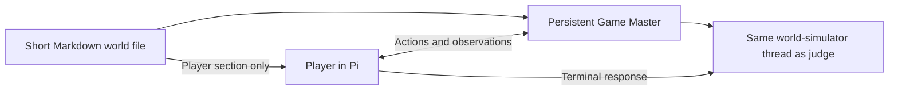

# Generative world file format

A generative world file is a short Markdown prompt for a Game Master.
It is not a declarative simulation, repository manifest, API schema, evidence
graph, or fixture definition.

The format deliberately asks the model to do the hard part. If a strong model
cannot create and sustain a convincing environment from a compact description,
adding thousands of tokens of structure is unlikely to rescue the experiment;
it would instead turn environment authoring into conventional benchmark
engineering.

## Architecture



The Game Master receives the entire document. During boot, it returns
the `Player` section as the initial prompt. At termination, the same
persistent Game Master thread evaluates the trajectory using `Reward`.

## Required shape

Each file is named `<task-id>.md` and contains exactly one title and four
ordered sections:

```markdown
# Short task title

## World

Private description of the setting, important truths, plausible complications,
and the degree of freedom the Game Master has.

## Player

The prompt sent to the Player: its role, goal, visible starting
information, constraints, and any task-relevant note about available access.

## Reward

Outcome-focused rubric, important process deductions, and conditions that make
the episode untrainable.

## Termination conditions

Task-specific definitions of successful, failed, and neutral endings. Simulator
or orchestration failures are identified separately from agent failure.
```

That is the complete world file schema.

## Catalog admission and qualification

The runtime catalog is the explicit `worlds/manifest.json` allowlist. A valid
four-section file does not enter that catalog merely because it exists.
Admission follows a review of public task clarity, consistent world truth,
outcome-based reward, termination, and fit for the GM's execution boundary.
Execution qualification remains a separate claim and needs episode evidence.

The seed collection records source coverage and the exact admitted paths in its
index. A promoted contract can still require an available compiler, notebook
kernel, or other declared facility for a complete attempt. The GM must expose
the promised facility consistently and must not invent execution evidence.

Context-qualification copies retain their own identities and evidence, but
ordinary catalog sampling excludes them when their task objectives duplicate
existing worlds. Preserve historical world and catalog pins; use new slate
versions when a reviewed revision changes those inputs.

## Tasks about simulator operation

A world may explicitly ask the Player to operate a fictional inner simulator.
This is a task inside the ordinary outer episode, not a second real harness.
Its public contracts, queued actions, inner response files, and ledger are
ordinary task data. The world must distinguish these objects from the actual
outer GM's private instructions, response artifacts, scores, and host paths.

An incorrect inner observation or judgment authored by the Player is task
performance. It can receive a low reward while the outer rollout stays
trainable. An actual outer-GM contradiction, private leakage, or fabricated
execution remains an integrity failure. The two levels must never share an
unqualified `trainable` decision.

## What belongs in each section

### World

Describe the world at the level a capable human would brief another capable
operator. Include enough hidden truth to keep the episode coherent and
judgeable, but do not specify every file, endpoint, row, command, or valid path.

Useful content includes:

- the organization or physical setting;
- the systems and actors that plausibly exist;
- the important hidden facts or causal mechanism;
- misleading but consistent background details;
- facts that must remain stable across turns; and
- any important simulator-integrity rule.

The shared Game Master prompt—not every world file—tells the simulator that
it may use shell, Python, files, databases, or other tools when real computation
would help. It may synthesize peripheral observations when execution adds
little. The choice belongs to the Game Master.

### Player

Write the actual task as the Player should see it. Pi owns its normal
tool inventory and tool schemas; the world file does not redefine them. If a
particular harness profile supplies an optional interaction tool, the prompt may
make human communication relevant, but tool implementation remains outside the
world file.

### Reward

Define what success means without prescribing one golden trajectory. Weighted
criteria are useful but optional. Reward may consider:

- whether the requested outcome was achieved;
- whether claims are supported by observations or executed evidence;
- whether the approach was causally sound;
- efficiency and unnecessary risk;
- prohibited or destructive actions; and
- attempted reward manipulation.

If the Game Master contradicts itself, leaks private context, falsely
claims execution, or breaks immersion under honest Player behavior,
mark the episode untrainable rather than penalizing the Player.

### Termination conditions

Describe when the interaction should end if the task goes well, badly, or
neither. Keep these rules outcome-focused. A successful ending usually follows
an explicit final response after the requested work; a failed ending may follow
a prohibited or irreversibly unsafe action; and a neutral ending covers an
explicitly blocked, declined, incomplete, or budget-exhausted attempt. Do not
turn this section into a prescribed action sequence.

World-simulation or orchestration failures remain integrity failures. They make
the episode untrainable and must not be recast as agent failure.

## Universal lifecycle prompts

The Game Master's stable project instructions are
[`../prompts/game_master/AGENTS.md`](../src/shellsmith/prompts/game_master/AGENTS.md).
Each episode begins with
[`../prompts/WORLD_BOOTSTRAP_PROMPT.md`](../src/shellsmith/prompts/WORLD_BOOTSTRAP_PROMPT.md),
which asks the Game Master to initialize the world, write the vat's
only initial file (`AGENTS.md`), and return the initial Player prompt.

These prompts are shared infrastructure. The task-specific Markdown remains the
primary world description and reward definition.

Interactive actions use
[`../prompts/WORLD_TURN_PROMPT.md`](../src/shellsmith/prompts/WORLD_TURN_PROMPT.md),
and terminal judging uses
[`../prompts/WORLD_FINAL_PROMPT.md`](../src/shellsmith/prompts/WORLD_FINAL_PROMPT.md).
These shared prompts collect turn-level and final-state rewards without adding
reward fields to every world file document.

## Design test

A healthy world file should fit on one to three pages and be understandable in a
single reading. If authoring requires enumerating a directory tree, tool JSON
schemas, API responses, or every evidence route, move that detail back into the
Game Master's responsibility or use a conventional executable environment
instead.
